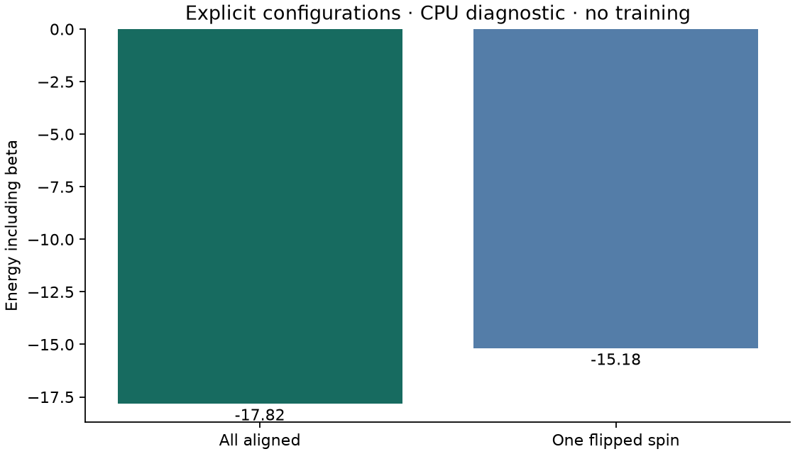

# Gated PixelCNN Ising/Wegner research code

Masked-convolution networks provide autoregressive lattice sampling, with a runnable GPU training driver for the three-dimensional Ising model.

**CPU checks cover masked-site causality, finite probabilities and known Ising energies.** TODO: validated training observables, sampling accuracy and speed; no quantitative research benchmark is saved.



## Quick start

From the repository root, install the pinned CPU validation environment:

```bash
python3 -m venv .venv
.venv/bin/pip install -r requirements-dev.txt
.venv/bin/python -m pytest -q
```

For training, choose a PyTorch build compatible with your CUDA environment. The driver requires a GPU; pass `--dev 0` explicitly because the default is inconsistent with list handling. Use `python 3d_ising_pixel.py --help` for the actual arguments. GPU training was not run during cleanup.

## Method

- Residual masked three-dimensional convolutions define conditional spin probabilities.
- The sampler fills lattice sites sequentially, calling the network repeatedly.
- Lightning manages training and TensorBoard logging.
- A variational loss combines log probability with periodic Ising energy.
- Other Ising and gauge energy helpers are included; separate end-to-end Wegner drivers are absent.

## Results

[Saved CPU diagnostic](results/diagnostic.json) evaluates explicit configurations, not trained samples. At lattice length three and beta 0.22, the aligned energy is −17.82 and a single flipped spin gives −15.18, agreeing with the periodic nearest-neighbour formula. `python scripts/diagnostic.py` regenerates the chart without external data.

## What didn't work

This snapshot does not establish a trained sampling advantage or reproduce a published physics benchmark. CPU tests cannot validate GPU training, thermodynamic observables or effective sample size. TODO: save reproducible training results and confirm the exact relationship to the [related publication](https://arxiv.org/abs/2503.08610).

## Tests, structure and licence

[](https://github.com/VChahar1/gated-pixelcnn-ising-wegner/actions/workflows/tests.yml)

`tests/` contains CPU numerical checks. `3d_ising_pixel.py` is the driver, `gate_pixel.py` is its active network, `gate_ising.py` is an alternative, and `py_func.py` contains energy helpers. Code: [MIT](LICENSE).
